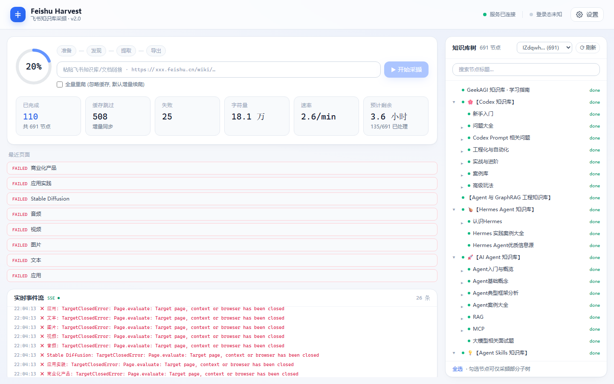

# Feishu Harvest — 飞书知识库采撷 v2.0

将你有权访问的飞书知识库/文档优雅地导出为本地 **Markdown / PDF**。
六层解耦架构 · 多 Tab 并行 · AIMD 自适应节流 · SQLite 断点续爬 · 实时仪表盘。

> 设计文档：[docs/ARCHITECTURE.md](docs/ARCHITECTURE.md)（架构与拓扑） ·
> [docs/STRATEGY.md](docs/STRATEGY.md)（效率/风控/稳定性/速度策略与开源方案对照）




---

## 实测战报（终极压测：GeekAGI 知识库，699 节点）

| 指标 | 结果 |
|---|---|
| 节点发现 | **699 个**（老版本同库只能发现 270 个，漏一半以上） |
| 层级深度 | **5 层**全覆盖（L1:25 / L2:120 / L3:438 / **L4:114 / L5:2**），最深链"知识库←案例库←合集←专题←文章" |
| 内容规模 | 699 页 / 3,448,445 字 / 3,495 张图片（1.3 GB）；单文档最大 25 万字 |
| 多维表格 | **47 页 API 直采**（含内嵌 base_refer / 画廊视图），卡片式排版；1 处内嵌表为飞书侧权限墙（诚实标注） |
| 文件节点 | **46 个全部落盘**：14 原生 PDF；30 Word + 2 Excel 因库开启"禁止下载"→ 自动降级预览转码 PDF（文本层完整，pypdf 可提取） |
| 合并 PDF | **3,764 页 / 241 MB / 12.6 分钟**（3495 图降采样缓存，二次导出更快） |
| 断点续爬 | 两次网络中断 + 一次浏览器崩溃 + 多次重启，零数据丢失，增量补齐全部缺口 |
| 韧性 | Tab 崩溃自动换新页；断网错误页识别为失败不产生假内容；连续 8 页导航失败自动熔断停止 |

## 快速开始

```bash
# Windows: 双击 启动.bat
# macOS / Linux:
./start.sh
```

脚本自动装依赖 → 启动服务 → 打开控制台 `http://127.0.0.1:19527`。
首次使用在弹出的浏览器中扫码登录（登录态持久化）。

开发模式：

```bash
cd backend && pip install -r requirements.txt && playwright install chromium
python -m harvest            # 后端 (托管已构建前端)

cd frontend && npm install && npm run dev   # 前端 HMR (端口 5273, /api 自动代理)
```

## 使用流程

1. 控制台粘贴知识库任意页面链接 → **开始采撷**；
2. 自动：发现全部节点（含深层级）→ 多 Tab 并行提取 → 按知识库分层级目录落盘 → README 索引 + 报告；
3. 中断/崩溃/断网后重新点击开始 —— 已完成节点缓存跳过，失败/缺口自动补齐。

## 漏爬检测与补爬

| 能力 | 说明 |
|---|---|
| 漏爬可视化 | 树面板「漏爬 N / 待爬 N」计数芯片；失败节点在树中直显错误原因，可切平铺过滤视图 |
| 一键补爬 | 「选中漏爬」→「采撷所选」，只重爬失败/缺口节点及其子树，不碰已完成的 |
| 查新页 | 一键重跑发现流程（库中节点作种子、不提取内容），找出上游新增页面并以 `pending` 进树，再勾选补爬 |
| 自动重试 | 失败/空内容/未登录/中断遗留节点在下次增量续爬时自动重试，只有 `done` 才走缓存 |
| 断网熔断 | 连续 8 页导航失败判为疑似断网，任务提前停止，已落盘内容不受影响 |
| 崩溃回收 | 进程崩溃/关机遗留的 `running` 节点与运行记录，下次启动自动回收为 `pending` / `interrupted` |

## 输出结构

```
backend/data/outputs/<知识库token>/     # 每个知识库独立目录, 互不污染
├── 章节名/子章节/…/页面标题.md         # 目录树 = 导航树 (最深实测 5 层)
│   └── _intro.md                      # 章节简介
├── images/                            # 全库图片 (按目录深度 ../images/ 相对引用)
├── selfcontained/                     # (可选) base64 自包含副本
├── feishu_docs.pdf                    # (可选) 合并 PDF (图片降采样+JPEG, 实测 3764 页 / 241MB)
├── README.md                          # 全库索引
└── CRAWL_REPORT.txt
```

## 功能与设置（16 项全部可视化，均真实接线）

| 分组 | 设置 |
|---|---|
| 并发与节奏 | 并发 Tab 数 (1-6) · 基础导航间隔 · 退避上限 · AIMD 自适应开关 |
| 超时与重试 | 导航超时 · 渲染等待上限 · 提取重试次数 · 图片并发数 |
| 内容类型 | 无法提取类型策略（占位/跳过）· 多维表格全视图导出 · 视频输出地址 |
| 导出与输出 | 导出格式 (md/pdf) · PDF 图片宽度 · 自包含副本 · 附件下载 · 启动前清空 · 输出目录 |

## 亮点

| | 说明 |
|---|---|
| **并行不失礼** | 多 Tab 消灭渲染等待；AIMD 学 Scrapy AutoThrottle，429/断流自动降速、顺畅缓慢提速 |
| **断点续爬** | SQLite WAL 状态机逐页落库；断网/崩溃/重启后增量补齐，已完成页缓存跳过；断网自动熔断 |
| **漏爬闭环** | 漏爬/待爬计数可视化 + 错误原因可见 + 查新页发现上游新增 + 勾选补爬，只重爬缺口 |
| **深层级发现** | 虚拟滚动深度展开 + 逐章节 BFS，实测覆盖 5 层 |
| **全类型覆盖** | 文档 / 多维表格(API 直采，含内嵌画廊视图，卡片式排版) / 文件管理页 / 附件下载(403 自动降级预览 PDF) / 不支持类型占位说明 |
| **内容保真** | 代码块自愈(repair_fences) · 导航壳剔除 · 飞书页面链接自动转纯文本（本地打开必报错）· 零宽水印清洗 |
| **优雅降级** | Tab 崩溃自动换新页 · 断网错误页识别为失败待重试 · 附件三级降级下载 |

## 项目结构

```
feishu-harvest/
├── docs/           # 架构 + 策略文档 + UI 预览
├── backend/harvest/
│   ├── core/       # 节流/熔断纯机制 (AIMD · 令牌桶 · 熔断器)
│   ├── store/      # SQLite WAL 节点状态机 (断点续爬/增量)
│   ├── transport/  # Playwright 生命周期 + PagePool (Tab 崩溃自愈)
│   ├── legacy/     # 提取内核 (唯一知道飞书 DOM 的层)
│   ├── pipeline/   # 发现/提取/写盘/PDF 编排
│   └── api/        # FastAPI + SSE (薄适配, 含诊断端点)
├── frontend/       # React + Vite + Tailwind 仪表盘
└── 启动.bat / start.sh
```

## 免责声明

- 仅抓取当前登录账号**有权查看**的内容，不绕过任何权限控制；
- 不使用代理池/IP 轮换/指纹伪装 —— 礼貌爬取（限速 + 退避 + 增量）是唯一策略；
- 仅供个人学习使用，内容版权归原作者；禁止大规模批量爬取或商用传播。
